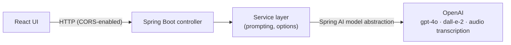

<div align="center">

# 🤖 Spring AI Projects

**Hands-on GenAI apps for Java backends: Spring Boot + Spring AI + OpenAI, with React front-ends**


</div>

Two small, focused projects that show how to wire LLM capabilities into a Spring Boot service through **Spring AI's** model abstractions, and expose them to a React UI over plain REST.

| Project | What it does | Spring AI | Backend port |
|---|---|---|---|
| [`spring-ai-demo`](spring-ai-demo) | Chat, text-to-image and a recipe generator | `1.0.0-M1` | 8080 |
| [`audio-transcribe`](audio-transcribe) | Upload an audio file, get a transcript (speech-to-text) | `1.0.0-M2` | 8080 |

> Both backends default to port 8080, so run them one at a time (or set `server.port` on one of them).

## 🧩 How it works



The controllers stay thin. Prompt construction and model options live in services, and Spring AI's starter handles the client configuration, so swapping the underlying model provider is a configuration change rather than a rewrite.

## 1️⃣ `spring-ai-demo`: chat, images, recipes

**Backend** (`spring-ai-demo/SpringAiDemo`): Java 17, Spring Boot 3.3, `spring-ai-openai-spring-boot-starter`

| Endpoint | Parameters | Description |
|---|---|---|
| `GET /ask-ai` | `prompt` | Chat completion for a prompt |
| `GET /ask-ai-options` | `prompt` | Chat completion with explicit model options (`gpt-4o`) |
| `GET /generate-image` | `prompt`, `quality` (default `hd`), `n` (1), `width` / `height` (1024) | Generates images with `dall-e-2`, returns a list of image URLs |
| `GET /recipe-creator` | `ingredients`, `cuisine` (default `any`), `dietaryRestriction` | Prompt-templated recipe generator |

**Frontend** (`spring-ai-demo/spring-ai-demo-react`): Create React App with `ChatComponent`, `ImageGenerator` and `RecipeGenerator`. Expects the backend at `http://localhost:8080`; the backend allows the dev origin `http://localhost:3000`.

## 2️⃣ `audio-transcribe`: speech-to-text

**Backend** (`audio-transcribe/audio-transcribe`): Spring Boot 3.3 + Spring AI OpenAI audio transcription

| Endpoint | Request | Response |
|---|---|---|
| `POST /api/transcribe` | `multipart/form-data` with a `file` part | Plain-text transcript (English, temperature `0`) |

The upload is written to a temporary file for the duration of the call and deleted afterwards.

**Frontend** (`audio-transcribe/audio-transcribe-frontend`): React 18 + Vite + Axios, with an `AudioUploader` component. Runs on `http://localhost:5173`, which the backend allows via CORS.

## 🚀 Running locally

**Prerequisites:** JDK 17+, Node.js 18+, an [OpenAI API key](https://platform.openai.com/api-keys).

The API key is **never committed**: each backend's `application.properties` reads it from an environment variable. Export that variable in the shell you start the backend from (the variable name is the `${...}` placeholder on the `spring.ai.openai.api-key` line of that file).

```bash
# 1. Backend  (pick one project)
cd spring-ai-demo/SpringAiDemo            # or: audio-transcribe/audio-transcribe
./mvnw spring-boot:run

# 2. Frontend (in another terminal)
cd spring-ai-demo/spring-ai-demo-react    # npm start    -> http://localhost:3000
# or
cd audio-transcribe/audio-transcribe-frontend   # npm install && npm run dev -> http://localhost:5173
```

## ⚠️ Notes

- Uses **milestone** Spring AI releases (`1.0.0-M1` / `M2`). APIs changed before GA, so upgrading to the stable `1.0.x` line will need small code changes.
- Calls to OpenAI are billed to your key; image generation is the most expensive endpoint.

## 🗺️ Roadmap

- [ ] Upgrade to Spring AI GA and add streaming chat responses
- [ ] Add a RAG example (vector store + document ingestion)
- [ ] Input validation, rate limiting and error handling on the endpoints
- [ ] Docker Compose for backend + frontend

## 📄 License

No license has been added yet. Until one is, all rights are reserved by the author.
